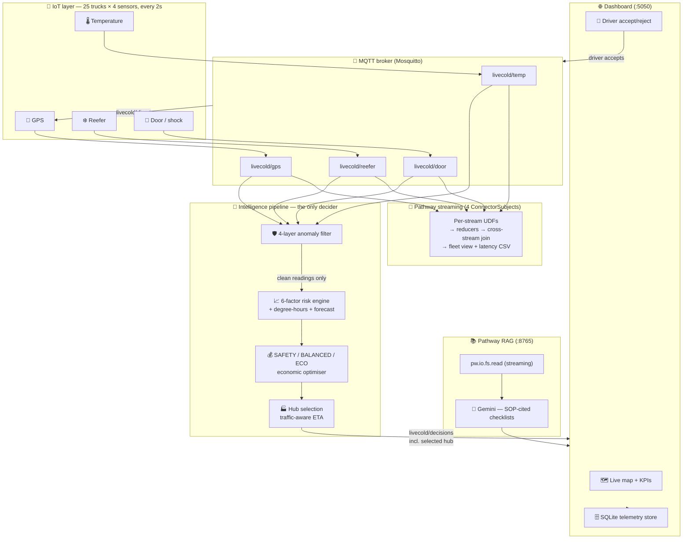

<div align="center">

# 🧊 LiveCold

### Real-Time Cold Chain Intelligence Platform

**4-stream IoT ingestion • Cargo-aware risk scoring • Economic diversion decisions**
**Built on [Pathway](https://pathway.com/) real-time streaming**

[]()
[]()
[](https://pathway.com/)
[]()
[]()
[]()

India loses an estimated **₹92,000 crore a year** to cold chain failures.
LiveCold watches refrigerated trucks in real time and decides — per shipment, in rupees —
whether to keep going or divert to cold storage.

</div>

---

## What it does

```
Traditional:  Sensor → Alert → Human reads email → Manual decision → Cargo already spoiled

LiveCold:     Sensor → Anomaly filter → 6-factor risk → Cost/carbon optimiser
                     → Hub selection → Driver accepts → Truck physically re-routes
```

The system does not just raise alarms. It **decides**, and it justifies each decision in
rupees: divert only when the expected cargo loss avoided exceeds the cost of diverting.

| Capability | Where it lives |
|---|---|
| **4 concurrent IoT streams** — temperature, GPS, reefer, door/shock | `sim/`, `pipeline/pathway_mqtt_bridge.py` |
| **4-layer anomaly filter** — bounds, rate-of-change, z-score, stuck sensor | `core/anomaly_detector.py` |
| **6-factor cargo-aware risk model** with per-cargo weights | `risk_engine_v2/` |
| **Predictive spoilage** — degree-hours + 30-minute temperature forecast | `risk_engine_v2/risk_calculator_v2.py` |
| **Three real routing modes** — SAFETY / BALANCED / ECO | `decision_engine_v2/economic_model.py` |
| **Confidence scoring** — factor agreement, signal duration, data staleness | `decision_engine_v2/confidence_scorer.py` |
| **Traffic-aware hub selection** across 15 Indian hubs | `core/hub_manager.py` |
| **Live GPS re-routing** — the truck actually changes course | `sim/gps_simulator.py` |
| **Driver-in-the-loop** — diversions are proposed, not commanded | `dashboard/app.py` |
| **Streaming RAG over the SOP** — edit the doc, next answer reflects it | `pipeline/pathway_rag_pipeline_v2.py` |
| **Durable telemetry** — SQLite compliance record per consignment | `dashboard/telemetry_store.py` |
| **CI/CD + AWS ECS deploy** | `.github/workflows/`, `deploy/` |

---

## Architecture

Four OS processes over an MQTT broker. This is the single most important fact about the
system: the simulators are a drop-in stand-in for real reefer telematics, so replacing them
with physical hardware changes nothing downstream.



**The rule:** the pipeline decides, the dashboard renders. Hub selection lives in the
pipeline and travels inside the decision payload, so the driver's notification and the
dashboard's proposal can never name different facilities.

---

## The decision, end to end

**1 · Filter the sensor before trusting it.** A diversion costs real money and real driver
goodwill. Four ordered checks, cheapest first, short-circuiting on the first hit:

| Layer | Catches | Response |
|---|---|---|
| L1 Physical bounds | `-999`, `500` — disconnected probe | Discard the reading |
| L2 Rate of change | 20 °C step in 2 s — electrical fault | Substitute last good reading |
| L3 Z-score (3.5σ, 20-sample window) | Plausible-looking outliers | Substitute rolling mean |
| L4 Stuck sensor (10 identical reads) | Frozen ADC — the silent failure | Accept value, flag for maintenance |

Rejected readings never enter the rolling window, so a burst of garbage cannot inflate σ
and teach the filter to accept the fault it exists to catch.

**2 · Score risk from all four streams.** Six signals, each normalised to [0, 1], weighted
per cargo type, then mapped through a sigmoid:

```
risk = σ( Σ wᵢ · scoreᵢ / Σ wᵢ )

  temp_deviation · exposure_time · eta_pressure · door_events · compressor · drift_rate
```

Vaccines weight temperature at 0.45 and tolerate **10 minutes** out of range; frozen meat
weights it at 0.20 and tolerates **120**. Same six signals, different physics.

Alongside this runs a **degree-hours** integral (`∫ (T − T_safe) dt`) that never decays —
the standard shelf-life formulation, and the model of irreversible damage.

**3 · Forecast 30 minutes ahead.** Least-squares regression over recent readings projects
where the cargo will be, guarded by a minimum 60-second observation window and a
physically achievable rate ceiling. This is what makes intervention possible while a hub
40 minutes away is still reachable.

**4 · Decide economically, under the shipment's routing mode.**

```
expected_loss_continue = P(spoilage) × cargo_value
total_divert_cost      = fuel + hub_handling + residual_risk × cargo_value
```

Diverting does not save the cargo, it saves ~70% of it — the truck still has to arrive and
the cargo is already partly warm. Pricing that residual risk into the diversion side is
what makes this a decision model rather than a dressed-up threshold.

**5 · Propose, don't command.** The driver sees the hub, a Google Maps link and an ETA, and
must accept. Only then does the truck re-route, and only then do the savings metrics move.

---

## The three routing modes

Genuinely different decision rules, not labels. Verified by
`decision_engine_v2/tests/test_routing_modes.py`.

| Mode | Default for | Rule |
|---|---|---|
| 🛡️ **SAFETY** | Vaccines, Pharmaceuticals | Diverts when risk ≥ 55% **regardless of cost**, *or* when economics justify it. A strict superset of BALANCED — property-tested so it can never divert less readily. |
| ⚖️ **BALANCED** | Dairy, Seafood, Frozen Meat, Ice Cream | Divert when `expected_loss > divert_cost + ₹500 buffer`. The buffer is a deadband so a break-even call doesn't oscillate on sensor noise. |
| 🌿 **ECO** | Fruits, Vegetables, Flowers | Prices carbon into the cost at ₹4,000/kg CO₂ and hard-vetoes detours above 20 kg CO₂ unless the loss avoided is 3× the diversion cost. |

Defaults come from `risk_engine_v2/configs/cargo_profiles.json`; operators can override per
shipment mid-journey via `POST /api/routing-mode/<id>`, and the override is sticky.

---

## The SOP is the single source of truth

`watched_docs/cold_chain_SOP.txt` carries a machine-readable block that the humans editing
the document also read:

```
<!-- PRODUCT_TEMP_RANGES
Dairy:2:6
Frozen_Meat:-18:-12
Vaccines:2:8
...
-->
```

`core/sop_parser.py` parses it, caches on mtime, and reloads without a restart. Those
ranges then drive:

- which products the fleet carries (`sim/shipment_factory.py`)
- the safe band the risk engine scores against (`risk_engine_v2/cargo_profiles.py`
  overlays SOP ranges onto the risk weights)
- what the dashboard displays and what the compliance report measures

**Edit the SOP, and system behaviour changes.** The Docker build fails if the SOP is
missing or unparseable, rather than silently falling back to hardcoded values.

The same file feeds the Pathway RAG service, so editing it also changes the SOP-cited
checklists the LLM produces — within about two seconds, no restart.

---

## Pathway integration

Pathway does two jobs, both real.

**1 · Four concurrent telemetry streams** (`pipeline/pathway_mqtt_bridge.py`). Each MQTT
topic gets its own `ConnectorSubject` and schema, so four readers run concurrently and are
joined in the dataflow rather than in Python:

```python
temp_events   = pw.io.python.read(MQTTStreamSubject(TEMP_TOPIC,   _temp_row,   "temp"),   schema=TempEventSchema)
gps_events    = pw.io.python.read(MQTTStreamSubject(GPS_TOPIC,    _gps_row,    "gps"),    schema=GpsEventSchema)
reefer_events = pw.io.python.read(MQTTStreamSubject(REEFER_TOPIC, _reefer_row, "reefer"), schema=ReeferEventSchema)
door_events   = pw.io.python.read(MQTTStreamSubject(DOOR_TOPIC,   _door_row,   "door"),   schema=DoorEventSchema)

# per-stream UDFs → incremental groupby reducers → cross-stream join
fleet_view = temp_agg.join(door_agg, ...).join(reefer_agg, ...)
```

Every event is stamped at publish and measured at ingest; percentiles are written to
`metrics/pathway_latency.csv` every 15 seconds, so the latency claim is measured rather
than asserted.

**2 · Live document intelligence** (`pipeline/pathway_rag_pipeline_v2.py`):

```python
documents = pw.io.fs.read(path=WATCHED_DOCS_DIR, format="binary", mode="streaming")
queries, response_writer = pw.io.http.rest_connector(host, port, route="/v2/answer", schema=QuerySchema)
response_writer(queries.select(result=build_answer(queries.prompt)))
```

The SOP cache is keyed on `(filename, mtime, size)`, so repeat queries do zero disk I/O but
any edit invalidates instantly — caching and liveness at the same time.

---

## Measured performance

Real numbers from the running system, not estimates. `GET /api/latency` reports both.

| Metric | Measured | Where |
|---|---|---|
| Pipeline latency (sensor publish → decision published) | **p50 ≈ 1 ms, p95 < 5 ms** | `livecold/latency`, `pipeline.get_metrics()` |
| UI refresh (decision → SSE frame on the wire) | **p95 < 100 ms** | `/api/latency` → `ui_refresh` |
| Pathway ingest latency, per stream | p50/p95/p99 every 15 s | `metrics/pathway_latency.csv` |
| SOP-cited checklist generation | **< 2 s** (Gemini 2.5 Flash, cached SOP context) | `/api/rag-query` |
| Concurrent shipments | **25**, independently tracked | `test_twenty_five_concurrent_shipments` |
| Anomalies filtered | ~9% of readings, all 4 layers exercised | `/api/anomalies` |

Latency is instrumented, not inferred: `_latency_samples` in the pipeline and
`_ui_latency_samples` in the dashboard, both reported as percentiles.

---

## Quick start

### Prerequisites
Python 3.11+, Mosquitto, a Google Gemini API key.

```bash
git clone https://github.com/di35117/Pathway-Hackathon.git
cd Pathway-Hackathon

python3.11 -m venv .venv && source .venv/bin/activate   # Windows: .venv\Scripts\activate
pip install -e ".[dev]"

cp .env.example .env       # then add your GOOGLE_API_KEY
mosquitto -c mosquitto.conf -d
```

Five terminals (or one `docker compose up`):

```bash
python main.py mqtt            # intelligence pipeline   (V2 engine by default)
python main.py dashboard       # dashboard              → http://localhost:5050
python main.py sim-all         # all 4 IoT simulators
python main.py rag             # Pathway RAG            → http://localhost:8765
python main.py pathway-bridge  # Pathway 4-stream bridge
```

Run the V1 engine for comparison: `python main.py mqtt --engine v1`.

### Docker

```bash
cp .env.example .env    # add GOOGLE_API_KEY
docker compose up -d
```

### No broker, no keys — pure engine demo

```bash
python demo_controller.py demo    # 4 showcase scenarios on real OSRM road geometry
python demo_controller.py full    # all 25 shipments, 30 simulated minutes
```

### Access points

| Service | URL |
|---|---|
| Dashboard | http://localhost:5050 |
| Driver view | http://localhost:5050/driver/SHP_1 |
| Analytics | http://localhost:5050/analytics |
| SOP editor | http://localhost:5050/sop-editor |
| Pathway RAG | http://localhost:8765/v2/answer |
| Health | http://localhost:5050/health |
| Latency | http://localhost:5050/api/latency |

---

## API reference

### Telemetry & decisions
| Endpoint | Method | Description |
|---|---|---|
| `/api/shipments` | GET | All active shipments with live state |
| `/api/alerts` | GET | Recent DIVERT + door-open alerts |
| `/api/metrics` | GET | System KPIs (₹ saved, CO₂, diversions) |
| `/api/stream` | GET | Server-Sent Events, one queue per client |
| `/api/latency` | GET | Measured pipeline and UI latency percentiles |
| `/api/history/<id>` | GET | In-memory temperature ring + 30-min prediction |
| `/api/telemetry/<id>` | GET | **Durable** telemetry, decisions, anomalies, compliance |
| `/api/fleet-summary` | GET | SQL aggregates across everything persisted |

### Decisions & hubs
| Endpoint | Method | Description |
|---|---|---|
| `/api/hubs` | GET | All 15 cold storage hubs |
| `/api/nearest-hubs/<id>` | GET | 3 best-ETA compatible hubs |
| `/api/accept-diversion/<id>` | POST | Driver accepts — truck re-routes |
| `/api/routing-mode/<id>` | GET/POST | Read or override SAFETY/BALANCED/ECO |
| `/api/shipment-report/<id>` | GET | Full compliance report incl. carbon credits |
| `/api/anomalies` | GET | Anomaly stats, global and per shipment |

### SOP & RAG
| Endpoint | Method | Description |
|---|---|---|
| `/api/sop-content` | GET/POST | Read or edit the SOP (triggers live reload) |
| `/api/sop-status` | GET | Sync status, change count |
| `/api/rag-query` | POST | Query the SOP via Pathway RAG, LLM fallback |

### Auth
`POST /api/auth/register` · `POST /api/auth/login` · `GET /api/auth/verify` ·
`POST /api/auth/logout` — JWT (HS256, 24 h) over bcrypt, with role-based route guards.

```bash
curl -X POST http://localhost:8765/v2/answer \
  -H "Content-Type: application/json" \
  -d '{"prompt": "What should I do if dairy temperature exceeds 8C?"}'
```

---

## Project structure

```
├── main.py                        # unified CLI
├── core/
│   ├── anomaly_detector.py        # 4-layer sensor filter
│   ├── hub_manager.py             # 15 hubs, traffic-aware ETA, zone matching
│   ├── alert_notifier.py          # driver / ops / client notifications
│   └── sop_parser.py              # SOP → temperature ranges (source of truth)
├── pipeline/
│   ├── livecold_pipeline.py       # the brain: 4 streams → risk → decision → hub
│   ├── pathway_mqtt_bridge.py     # Pathway: 4 concurrent ConnectorSubjects
│   └── pathway_rag_pipeline_v2.py # Pathway: streaming RAG over the SOP
├── risk_engine_v2/                # 6-factor cargo-aware risk (live default)
├── decision_engine_v2/            # SAFETY/BALANCED/ECO + confidence scoring
├── decision_engine/               # V1 single-factor engine (fallback, --engine v1)
├── simulation_v2/                 # OSRM road routing, traffic bands, driver stops
├── sim/                           # MQTT IoT simulators (4 streams + fault injection)
├── dashboard/
│   ├── app.py                     # Flask, SSE, 36 routes
│   ├── telemetry_store.py         # SQLite persistence, batched writes
│   ├── auth.py / models.py        # JWT + bcrypt + audit log
│   └── templates/                 # Leaflet dashboard, driver view, analytics
├── frontend/                      # React 19 + Vite (auth wired; ops views in progress)
├── watched_docs/cold_chain_SOP.txt
├── deploy/                        # ECS task definition + runbook
└── .github/workflows/             # CI (lint, tests, docker) + AWS deploy
```

---

## Testing

```bash
pytest              # 162 tests
ruff check .        # clean
```

| Suite | Covers |
|---|---|
| `core/tests/` | SOP parsing and live reload, all 4 anomaly layers, window poisoning |
| `decision_engine/tests/` | V1 risk **property tests** — monotonic, bounded, never saturates |
| `decision_engine_v2/tests/` | Economics, confidence, and that the 3 modes genuinely differ |
| `risk_engine_v2/tests/` | Cargo profiles, exposure hysteresis, drift regression |
| `simulation_v2/tests/` | Haversine, polyline traversal, traffic bands, driver stops |
| `pipeline/tests/` | Full integration: 4 streams → decision, dedup, latency, 25 shipments |
| `dashboard/tests/` | SQLite round-trip, compliance maths, backpressure |

Notable property test: `test_never_saturates_to_certainty` and
`test_strictly_increasing_across_the_operational_range` exist because an earlier risk model
saturated to exactly 1.0 past 3 °C of deviation, making the "probability" a step function.

---

## Deployment

CI runs lint, tests on Python 3.11 and 3.12, a Pathway import smoke test, and a Docker
build that **asserts the SOP parses inside the image**.

Deploys go to ECS Fargate via OIDC (no static AWS keys), tagged by commit SHA, gated on a
GitHub environment approval, and wait for service stability so a failed healthcheck rolls
back automatically. Full runbook and the scale-out path in [`deploy/README.md`](deploy/README.md).

---

## Configuration

| Variable | Default | Description |
|---|---|---|
| `GOOGLE_API_KEY` | — | Gemini key (required for RAG). Extra `*_API_KEY` vars auto-rotate. |
| `MQTT_HOST` / `MQTT_PORT` | `localhost` / `1883` | Broker location |
| `LIVECOLD_ENGINE` | `v2` | `v1` runs the legacy single-factor engine |
| `JWT_SECRET` | dev default | **Must be set in production** |
| `SUPER_ADMIN_EMAIL` / `SUPER_ADMIN_PASSWORD` | — | Bootstrap admin |
| `ORS_API_KEY` | — | Optional OpenRouteService fallback for routing |

Tunable without touching code: `risk_engine_v2/configs/cargo_profiles.json` (weights,
tolerances, mode defaults), `decision_engine_v2/configs/cost_config.json` (fuel, carbon
price, thresholds), `simulation_v2/configs/` (traffic bands, driver stops).

---

## Known limitations

Stated plainly, because they are the honest boundary of what this demonstrates.

- **Telemetry is simulated.** The physics are grounded — ~0.5 °C/min with doors open,
  real OSRM road geometry, traffic bands calibrated to Indian metro congestion — but the
  model parameters need real reefer data to be *calibrated* rather than merely reasoned.
- **The 70% risk-reduction factor is asserted, not fitted.** With historical spoilage
  outcomes it should be learned per hub and per cargo type.
- **Two frontends.** The Jinja dashboard is the shipped product. The React app has auth
  wired end to end; its company and driver views still render mock data.
- **Single-node.** MQTT at QoS 0 has no replay, and per-shipment state is in process
  memory. The decision logic is a pure function of one shipment's state with no
  cross-shipment joins, so it partitions cleanly by `shipment_id` — the scale-out path is
  Kafka plus Redis, documented in `deploy/README.md`.
- **The anomaly filter is tuned for false positives.** A genuinely fast real excursion can
  look like an L2 rate fault. The mitigation is corroboration across independent signals
  (compressor and door state), which the risk engine already consumes but the filter does
  not yet cross-check.

---

## License

MIT
